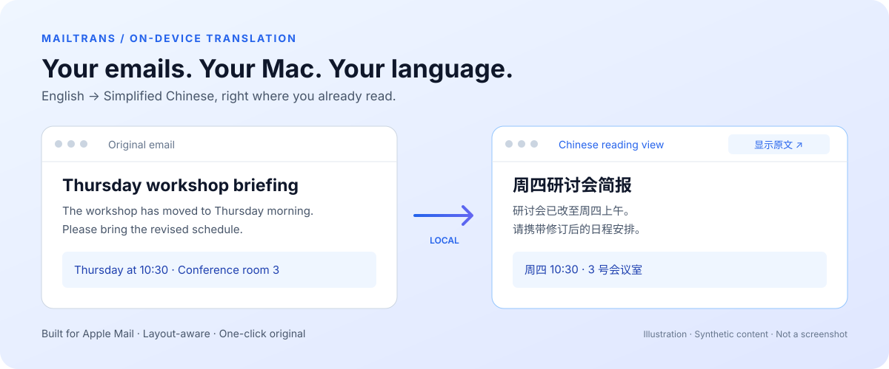

<div align="center">
  
  <h1>MailTrans</h1>
  <p><strong>英文邮件，中文阅读。继续使用 Apple Mail。</strong></p>
  <p>基于 MailKit 与苹果本地 Translation 框架的 macOS 邮件阅读扩展。</p>
  <p>
    
    
    
    <a href="LICENSE"></a>
    
    <a href="https://github.com/luoshuang148/MailTrans/actions/workflows/ci.yml"></a>
  </p>
  <p><a href="README.md">English</a> · <strong>简体中文</strong></p>
  <p><a href="https://github.com/luoshuang148/MailTrans/releases/tag/v0.11.1">预发布版本</a> · <a href="docs/getting-started.zh-CN.md">安装与使用</a> · <a href="CHANGELOG.md">更新记录</a> · <a href="https://github.com/luoshuang148/MailTrans/issues/new/choose">反馈问题</a> · <a href="CONTRIBUTING.md">参与贡献</a></p>
</div>



MailTrans 在 Apple Mail 的阅读位置将邮件正文翻译为**简体中文**。英文邮件默认显示原文，后台准备译文，点击即可查看中文。翻译由苹果本地模型完成，邮箱里的原始邮件保持不变。

> **开发预发布版。** 可从 [v0.11.1](https://github.com/luoshuang148/MailTrans/releases/tag/v0.11.1) 下载应用 ZIP 与 SHA-256 校验文件，或从源码构建。应用为临时签名，**未经公证**，macOS 可能阻止下载副本。已在 Apple Silicon / macOS 26.4 本地验证，其他独立 Mac 的安装尚未验证。详见[安装指南](docs/getting-started.zh-CN.md)及[兼容性清单](docs/compatibility.md)。

## 功能

| 功能 | 实际体验 |
| --- | --- |
| 英文自动译为中文 | 打开英文邮件后后台翻译，仍默认显示原文；点击**翻译为中文**立即切换到已准备的译文。 |
| 一键对照原文 | 中文视图点击**显示原文**，原文视图点击**翻译为中文**。已有译文直接使用缓存。 |
| 中文原文保持原样 | 简体、繁体中文正文不插入按钮、不替换内容、不写翻译缓存；中文开头的回复即使带英文签名或引用也保留原样。 |
| 尽量保留排版 | 保留 HTML 结构、表格、链接、内嵌图片及附件字节；译文长度变化可能影响换行与列宽。 |
| 本地翻译 | 使用苹果 Translation 与已下载的语言模型，没有云端翻译接口或自动云端回退。 |
| 菜单栏与设置 | 提供暂停自动翻译、取消任务、重试上次失败及设置帮助；可选监听器随 Mail 启动与退出。 |

Mail 未打开时也可完成首次设置。翻译任务在 120 秒后超时，支持取消并防止迟到结果覆盖原文。暂停自动翻译会记住选择，手动翻译仍可使用。

当前翻译目标和操作按钮为中文。其他源语言可在苹果语言模型支持时手动翻译。

## 快速开始

使用开发版应用：下载并解压 ZIP，将 `MailTrans.app` 移入 `/Applications` 后打开。首次设置会引导打开 Mail、启用扩展、准备语言包，并提供可选自动联动。详见[安装与启用](docs/getting-started.zh-CN.md#安装与启用)。

从源码构建需要 **Apple Silicon、macOS 26.4 或以上、安装在 `/Applications/Xcode.app` 的完整 Xcode，以及 Python 3**。已验证的构建环境为 Xcode 26.6 / macOS SDK 26.5，其他工具链尚未验证。

```sh
git clone https://github.com/luoshuang148/MailTrans.git
cd MailTrans
python3 outputs/mail-translation-probe/source/build.py
```

构建会执行原生测试、打包扩展及辅助程序，生成临时签名的 `outputs/mail-translation-probe/MailTrans.app`，不会自动安装或启用后台服务。

接着按照[安装指南](docs/getting-started.zh-CN.md#安装与启用)，将应用放入 `/Applications`，在 Mail 中启用扩展并准备语言模型。已有安装时请先阅读更新步骤。

## 工作方式

1. **MailKit 阅读扩展**接收邮件，保留原始 MIME 到临时本地缓存；中文原文直接交由 Mail 展示。
2. **菜单栏宿主**选取可翻译正文，通过 **Swift worker** 调用苹果本地 Translation 框架。
3. 扩展在 Mail 中按需显示译文。点击**显示原文**时恢复原始内容，并附加独立控制条；不向邮箱写回修改。

实现细节见[架构与源码地图](docs/architecture.md)，包括 MIME 处理、任务失效控制及可选生命周期监听器。

## 隐私与缓存

- 没有云端翻译 API、密钥配置或遥测；首次准备语言模型可能需要从 Apple 下载。
- 临时缓存包含原文（**可能含附件**）、译文和显示状态，位于扩展的本地容器，不写入仓库。
- 最多缓存 **20 封**，**30 分钟未使用**后失效；运行中定期清理，正常退出清空。强制结束后可能留有文件，下次运行时清理。
- **清空本地缓存**不删除邮箱邮件或语言包；刷新后 Mail 可能重新缓存当前原文。
- 远程图片沿用 **Apple Mail 已有的隐私设置**。本地翻译不意味着邮件中的远程内容不会联网。

详细说明见[缓存与隐私](docs/getting-started.zh-CN.md#缓存与隐私)和[安全反馈政策](SECURITY.md)。反馈时请使用人工邮件，不上传真实邮件或缓存。

## 当前限制

- 仅翻译正文，不翻译主题、发件人标头、图片文字、附件内容与代码块。
- 跳过签名、加密及无法可靠解析的邮件。原始邮件上限 10 MB；单文字节点上限 10,000 字符；整封可翻译文字上限 200,000 字符。
- 短标题、专业术语和混合语言识别可能不够准确，可随时对照原文。
- 一次翻译一封。自动翻译失败保留原文，可手动重试。
- 当前构建未支持或验证 Intel Mac、旧版 macOS、正式分发签名、公证和跨机器安装。

## 反馈与贡献

先查看[常见问题](docs/getting-started.zh-CN.md#常见问题)和[已有 Issues](https://github.com/luoshuang148/MailTrans/issues)，再提交[问题报告或功能建议](https://github.com/luoshuang148/MailTrans/issues/new/choose)。欢迎中文或英文反馈。

欢迎改进文档、添加人工测试邮件、开展无障碍与兼容性验证，或完善翻译流程。构建和提交要求见[贡献指南](CONTRIBUTING.md)。

## 许可证

[MIT](LICENSE) © 2026 MailTrans contributors。MailTrans 是独立项目，与 Apple 无隶属或背书关系。
