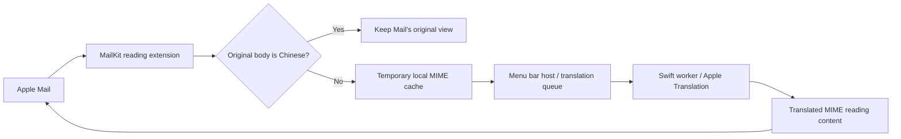

# Architecture and source map

[Home](../README.md) · [Getting started](getting-started.md) · [Contributing](../CONTRIBUTING.md)

MailTrans is a macOS menu bar application containing a MailKit reading extension. The application runs translation and cache-management work; the extension supplies reading content to Mail. An optional separate lifecycle watcher starts the application when Mail is running.

## Message flow

Original Simplified and Traditional Chinese bodies bypass cache reads/writes and host notifications. Detection uses visible body text, with a conservative Chinese-first-paragraph rule for replies containing English signatures or quotes.

English bodies are queued automatically, one message at a time. Other supported languages use the manual body control. The worker exchanges ordered text arrays over JSON with the host; it does not receive a whole MIME package. `TranslationProvider` separates engine integration from MIME parsing, but only `apple-local` is implemented.

## Setup, controls, and bounded work

`MTSetupController` provides first-run and on-demand settings. `MTAppManagement` queries registration and model availability, manages the known per-user LaunchAgent without Python, and confirms the exact app path before uninstall. Mail's enabled checkbox still needs user confirmation. Lifecycle management refuses Downloads/translocated paths.

The host persists `MTAutomaticTranslationEnabled` (default true). Pause cancels automatic work and keeps manual translation/cached switching available. The menu can cancel a running task or retry the exact last failed cached message. Error icons and tooltips expose failure; no mail content is logged.

`MTProcessRunner` handles nonblocking stdin/stdout, a 120-second translation deadline, an 8 MiB output cap, cancellation, and TERM→KILL escalation. Normal app shutdown also synchronously stops owned runners. Native language preparation has a separate 15-minute download window. Automatic watcher launches pass `--mail-session`; manual launches can retain setup while Mail is closed.

## Original and translated views

`MIMECore` handles MIME structure, transfer encoding, character sets, visible HTML text, and temporary message state. A SHA-256 content key isolates each message.

- Translated content replaces selected visible text while retaining supported structure, links, image data, and attachments.
- Original display wraps the intact original MIME package with a separate HTML control part. It does not rebuild original body or attachment bytes, or write back to the mailbox.
- **显示原文** cancels queued work or invalidates active results for that message. Clear-cache and app-exit paths also invalidate requests, preventing late results from restoring discarded translations.
- Both views defer remote-content handling to Mail. No plugin-specific extra remote-image block is applied.

Signed/encrypted messages, unsafe parse results, and content above the documented limits are skipped.

## Lifecycle and process boundaries

The optional per-user LaunchAgent runs `MailTransLifecycle`, an invisible watcher using KVO on `NSWorkspace.runningApplications`. It observes application state rather than polling email or reading message content.

Session identity uses Mail's process ID and launch time. Manual quit suppresses relaunch in that session; a new Mail session resets it. Async state transitions and launch callbacks are serialized on the main thread, including waiting for an old host to finish quitting before launching a replacement.

The host and helper share preferences through a common factory: the current app's own domain uses `standardUserDefaults`, and other contexts use a suite. A bundled app, nested helper, and CLI are tested as real separate processes; an unbundled single-process fixture is insufficient to verify this behavior.

## Source map

Sources currently live under [`outputs/mail-translation-probe/source/`](../outputs/mail-translation-probe/source/). The directory name and internal IDs are retained for compatibility.

| File | Responsibility |
| --- | --- |
| `ProbeApp.m` | Menu bar UI, language detection, automatic queue, worker calls, view switching, model preparation, and Mail refresh |
| `ProbeExtension.m` | MailKit reading extension, original preservation, reading content, and host notifications |
| `MIMECore.h` / `MIMECore.m` | MIME/HTML parsing, text selection, controls, cache, request invalidation, and queue |
| `TranslationProvider.swift` | Provider protocol and JSON input/output types |
| `TranslationWorker.swift` | Apple on-device engine and provider registry |
| `LanguageSetup.swift` | Native language-model preparation UI |
| `MailLifecycle.h` / `MailLifecycle.m` / `LifecycleMain.m` | Process observation, shared preferences, session suppression, and launch/quit handling |
| `MTProcessRunner.h` / `MTProcessRunner.m` | Bounded child-process I/O and cancellation |
| `MTSetupController.h` / `MTSetupController.m` | Native first-run/settings/help UI |
| `MTAppManagement.h` / `MTAppManagement.m` | Native lifecycle management and confirmed exact-app uninstall |
| `package_release.py` | Validated development app ZIP and checksum |
| `manage_lifecycle.py` | Enable, disable, and inspect the per-user watcher |
| `build.py` | Native checks, compilation, icon packaging, fixture generation, ad-hoc signing, and signature verification |
| `CoreTests.m` / `AppTests.m` / `ExtensionTests.m` | Synthetic MIME, host, and extension checks |
| `LifecycleTests.m` / `LifecycleFixture.m` | Real test-application lifecycle checks |
| `PreferencesFixture.m` / `verify_lifecycle_preferences.py` | Real cross-process preference sharing checks |
| `verify_worker.py` | Installed-worker translation, ordering, Chinese preservation, and error checks |

## Stable identifiers

| Item | Value |
| --- | --- |
| Host bundle ID | `local.codex.mailtranslationprobe` |
| Extension bundle ID | `local.codex.mailtranslationprobe.extension` |
| Watcher LaunchAgent | `local.codex.mailtranslationprobe.lifecycle` |
| Body-control URL scheme | `mailtranslationprobe` |
| Implemented translation provider | `apple-local` |

Body-control URLs use strictly validated actions and a 64-character SHA-256 message key. Changes to IDs, cache structure, or control URLs need a migration plan.

## Validation and history

See [CONTRIBUTING.md](../CONTRIBUTING.md) for checks appropriate to each change. A native build, real local-model execution, and Mail UI rendering are three distinct forms of verification.

[Historical test records](../outputs/mail-translation-probe/测试记录.md) and earlier [lifecycle design notes](superpowers/specs/2026-10-14-mailtrans-lifecycle-design.md) are retained as development history. They may describe older behavior or a particular test environment; current user documentation and source take precedence.
